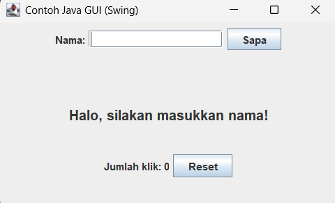
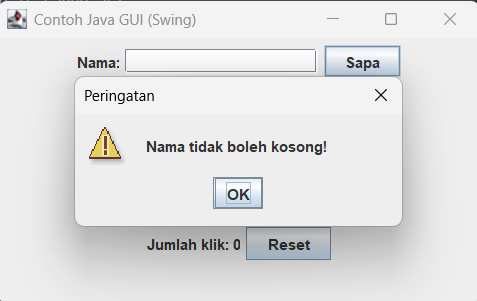
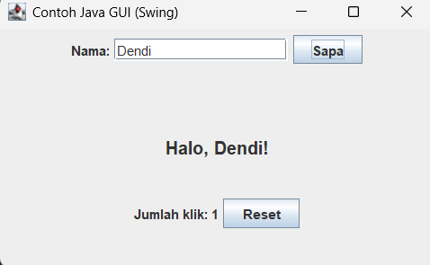

# Informasi Komponen GUI beserta Buktinya

## 1. Komponen GUI

| Komponen | Class / Interface | Penggunaan |
|---|---|---|
| Top-level Container | `JFrame` | `ContohGUI` (jendela utama) |
| Intermediate Container | `JPanel` | `panelAtas`, `panelBawah` |
| Atomic Component | `JLabel`, `JTextField`, `JButton` | label, input nama, tombol Sapa dan Reset |
| Layout Classes | `GridLayout`, `FlowLayout` | `GridLayout` (layout utama), `FlowLayout` (tiap panel) |
| Event Listener | `ActionListener` | event klik tombol Sapa dan Reset |

## 2. Screenshot
### - Tampilan

### - Event Listener

### - Hasil
